# Práctica 06: Terraform + AWS EC2

**Alumno:** Jean Franco Juárez Lozano
**Ciclo:** DAW - Despliegue de Aplicaciones Web
**Fecha:** 18/11/2026

## 1. Introducción
En esta práctica se automatiza el aprovisionamiento de infraestructura en AWS utilizando Terraform como herramienta de Infrastructure as Code. En lugar de crear la instancia EC2 y su configuración de red manualmente desde la consola, como en las prácticas anteriores, se describen en ficheros de código que Terraform aplica sobre AWS. El trabajo se hizo en dos fases: primero se creó una instancia básica, se analizaron sus limitaciones y después se amplió el código con un Security Group y un Key Pair para poder administrarla por SSH.

## 2. Terraform
Terraform es una herramienta de HashiCorp que permite definir la infraestructura de forma declarativa: se describe el estado deseado y Terraform calcula y ejecuta los cambios necesarios. Funciona mediante *providers*, que son los plugins que se comunican con cada plataforma (en este caso `hashicorp/aws`).

Comandos utilizados:

| Comando | Función |
|---|---|
| `terraform version` | Comprueba la versión instalada |
| `terraform init` | Prepara el directorio y descarga el provider |
| `terraform validate` | Valida la sintaxis y coherencia de la configuración |
| `terraform plan` | Muestra los cambios que se harían, sin ejecutarlos |
| `terraform apply` | Ejecuta los cambios en AWS |
| `terraform output` | Muestra los valores de salida |
| `terraform destroy` | Elimina los recursos gestionados |

Versión utilizada: `v1.17.2`.

## 3. AWS
Se utiliza AWS Academy (Learner Lab), región `us-east-1`. Terraform se autentica con las credenciales temporales del laboratorio (`AWS_ACCESS_KEY_ID`, `AWS_SECRET_ACCESS_KEY` y `AWS_SESSION_TOKEN`), configuradas como variables de entorno en la terminal. Estas credenciales caducan al reiniciar el laboratorio, por lo que hay que volver a copiarlas.

Servicios y recursos de AWS implicados: EC2 (instancia), Security Groups (firewall virtual) y Key Pairs (acceso SSH).

## 4. Infrastructure as Code
Infrastructure as Code (IaC) consiste en definir y gestionar la infraestructura mediante ficheros de código en lugar de hacerlo manualmente en una consola. El enfoque manual de las prácticas anteriores es válido para aprender, pero es lento, difícil de reproducir, propenso a errores y complicado de mantener. Con IaC la infraestructura queda documentada en el propio código, se puede versionar en Git, repetir en otra cuenta o región y destruir con un solo comando.

## 5. Configuración realizada

### 5.1 Estructura del proyecto

```text
practica06-terraform/
├── requisitos-practica06-terraform.md
├── README.md
├── terraform/
│   ├── main.tf
│   ├── variables.tf
│   ├── outputs.tf
│   └── terraform.tfvars
├── capturas/
└── docs/
    └── arquitectura-practica06.png
```

Arquitectura: 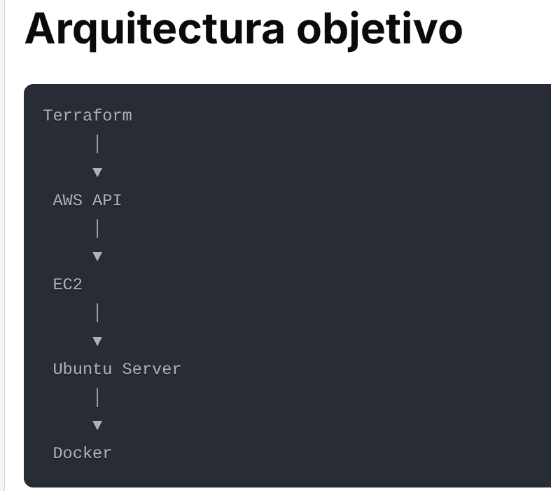

### 5.2 Credenciales
Las tres credenciales se obtuvieron en *AWS Details* del Learner Lab y se exportaron como variables de entorno en la terminal desde la que se ejecuta Terraform:

```bash
export AWS_ACCESS_KEY_ID="..."
export AWS_SECRET_ACCESS_KEY="..."
export AWS_SESSION_TOKEN="..."
export AWS_DEFAULT_REGION="us-east-1"
```

No se guardaron en ningún fichero del repositorio. La captura 04 muestra solo los nombres de las variables, con los valores ocultos.

### 5.3 `variables.tf`
Define las variables `region`, `ami`, `instance_type`, `instance_name` y, en la segunda fase, `key_name` (con valor `practica04`). Los valores concretos de región, AMI y tipo de instancia están en `terraform.tfvars`.

### 5.4 `main.tf` (fase 1)
Contiene el bloque `terraform` con el provider `hashicorp/aws`, el provider configurado con la región y un recurso `aws_instance` llamado `servidor`, con la AMI y el tipo de instancia tomados de las variables.

### 5.5 `outputs.tf`
Muestra la IP pública (`ip_publica`) y el ID de la instancia (`id_instancia`).

### 5.6 `main.tf` (fase 2)
Se añadió un recurso `aws_security_group` (`practica06-sg`) con reglas de entrada para SSH (22), HTTP (80) y HTTPS (443) y una regla de salida abierta. El recurso `aws_instance` se modificó para usar `key_name = var.key_name` y `vpc_security_group_ids = [aws_security_group.servidor_sg.id]`.

La regla de salida es necesaria porque Terraform elimina la regla de salida que AWS crea por defecto, y sin ella la instancia no podría descargar nada.

## 6. Recursos creados

| Fase | Recurso | Descripción |
|---|---|---|
| 1 | `aws_instance.servidor` | Instancia EC2 `t2.micro` con Ubuntu Server 24.04, sin clave ni Security Group propio |
| 2 | `aws_security_group.servidor_sg` | Firewall que permite 22, 80 y 443 |
| 2 | `aws_instance.servidor` (recreada) | Misma instancia con el Key Pair `practica04` y el Security Group asociado |

Identificadores de la ejecución: «i-0987914f22ded4b6c     y     32.200.199.94».

### Evidencias

| Nº | Descripción | Captura |
|---|---|---|
| 01 | AWS Academy y credenciales disponibles | 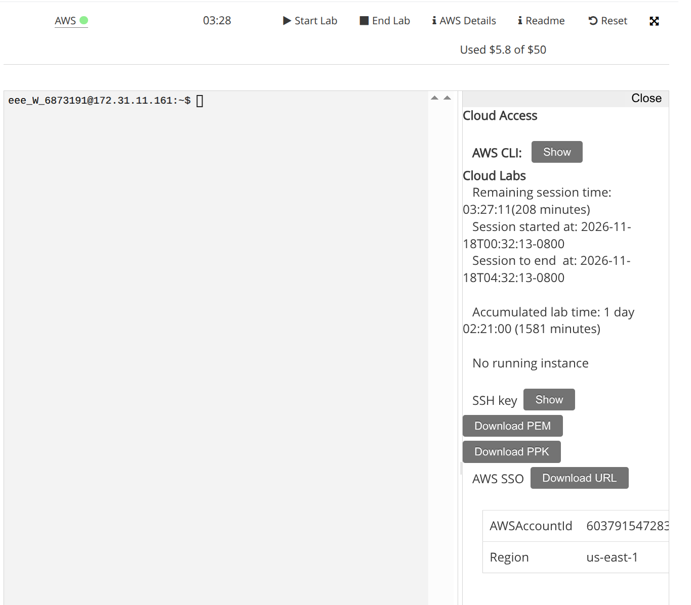 |
| 02 | Estructura del proyecto | 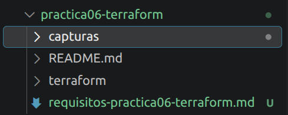 |
| 03 | Versión de Terraform | 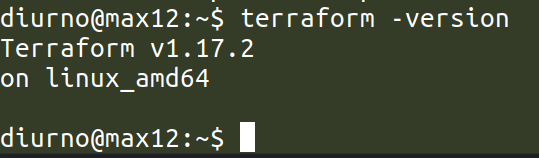 |
| 04 | Credenciales AWS configuradas | 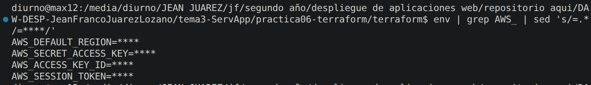 |
| 05 | Ficheros de Terraform | 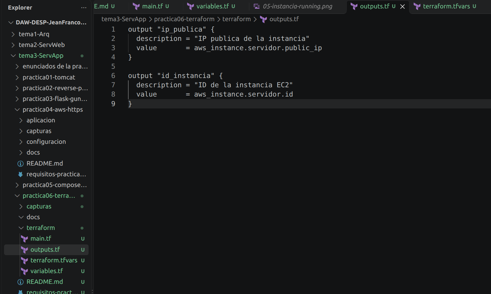 |
| 06 | `terraform init` | 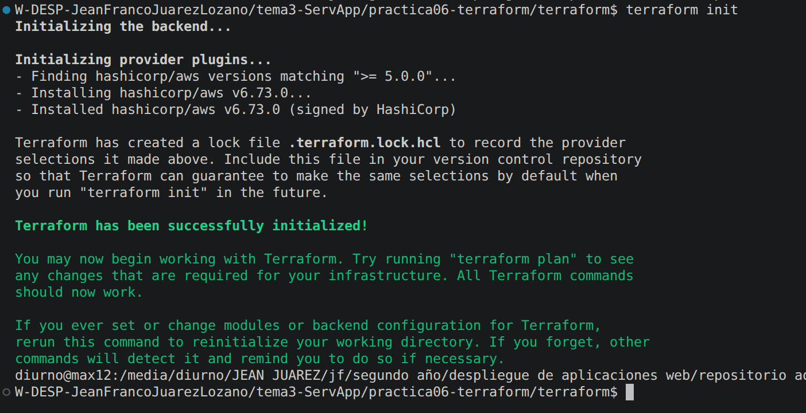 |
| 07 | `terraform validate` | 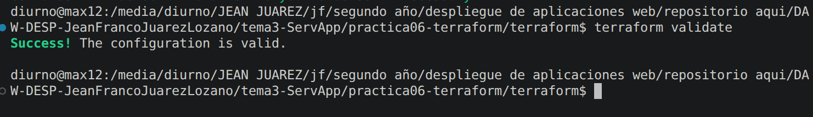 |
| 08 | `terraform plan` | 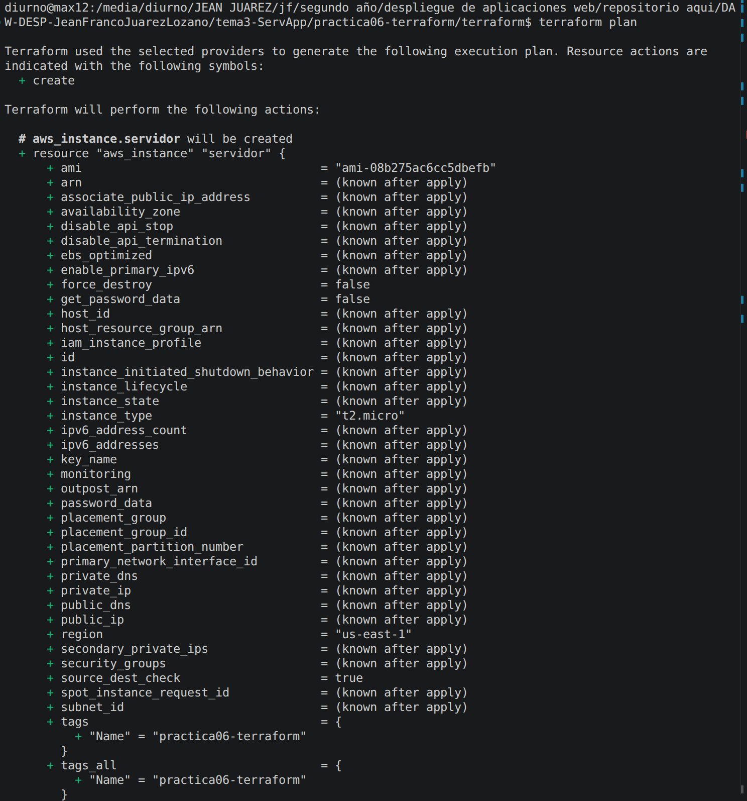 |
| 09 | `terraform apply` | 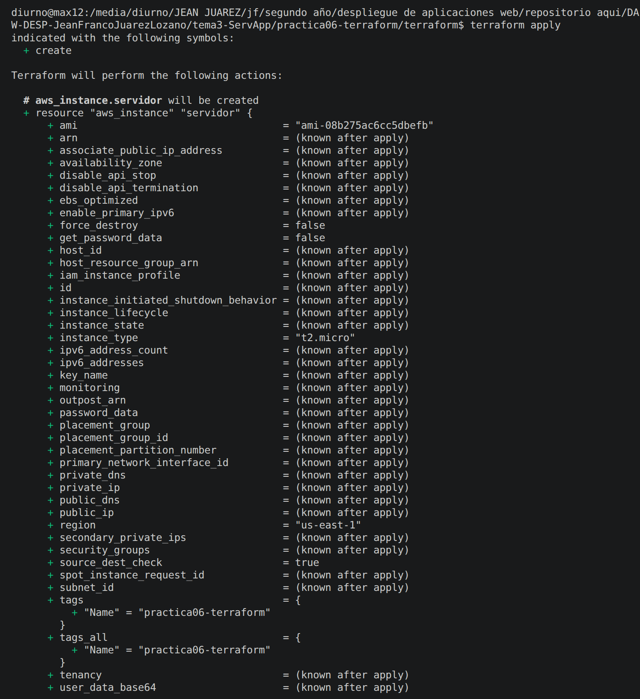 |
| 10 | Instancia creada en la consola de AWS | 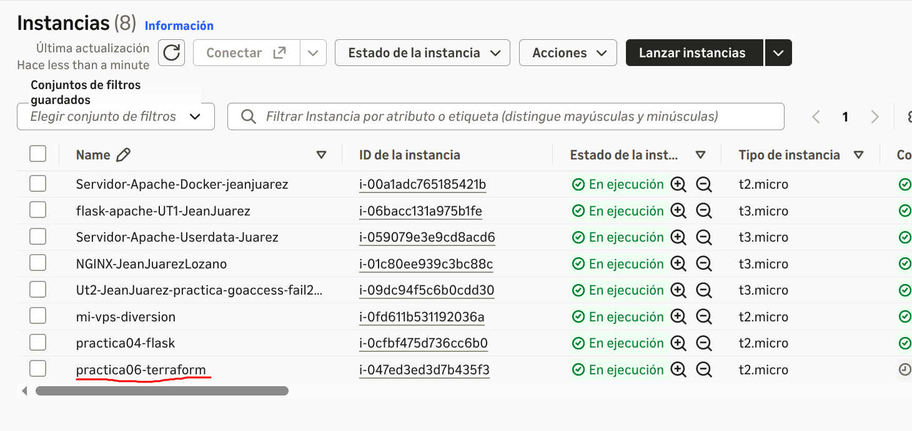 |
| 11 | `terraform output` | 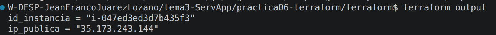 |
| 12 | Security Group en `main.tf` | 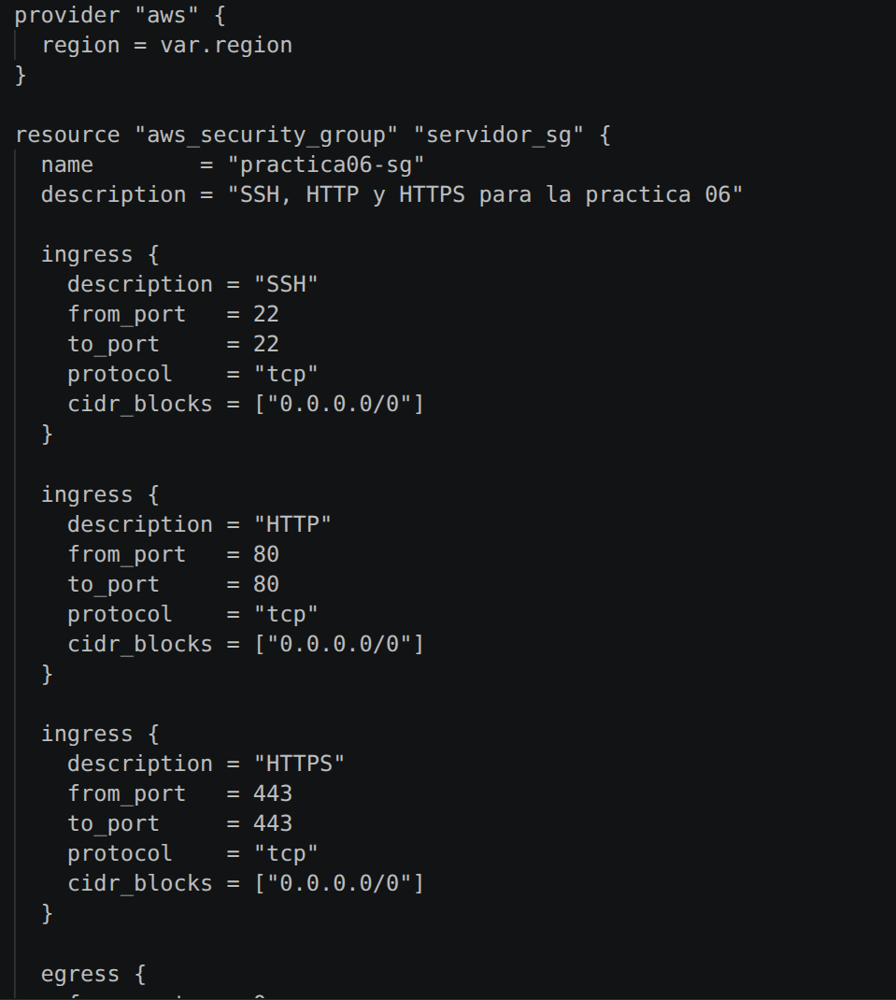 |
| 13 | `variables.tf` con el Key Pair | 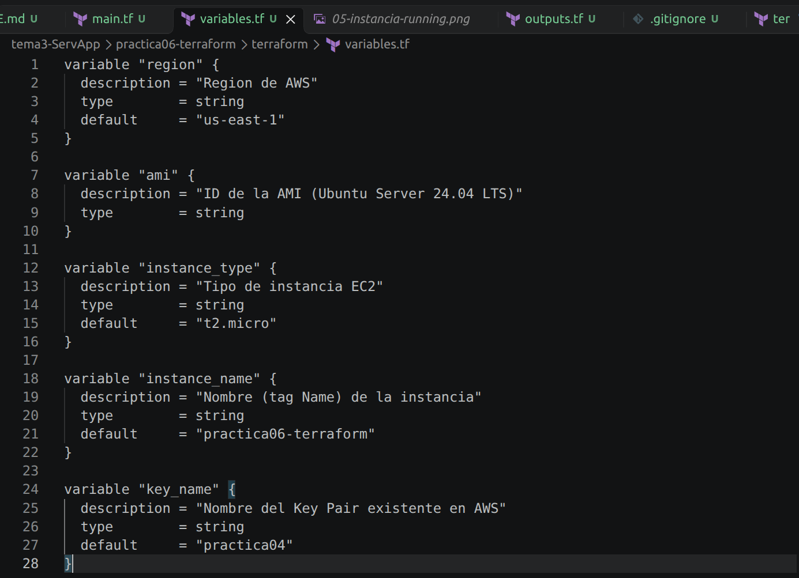 |
| 14 | Key Pair en el recurso EC2 | 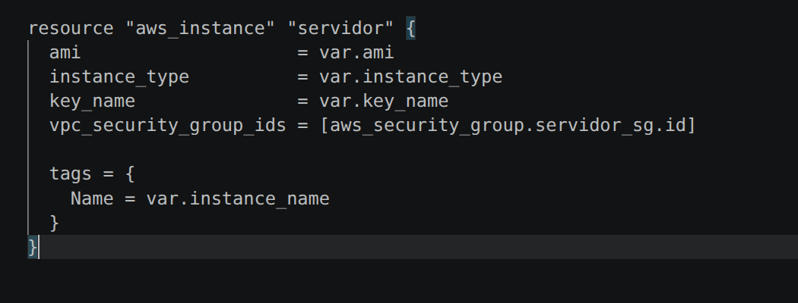 |
| 15 | `terraform validate` tras los cambios | 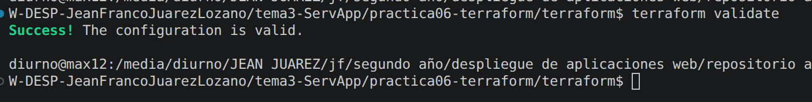 |
| 16 | `terraform plan` de la modificación | 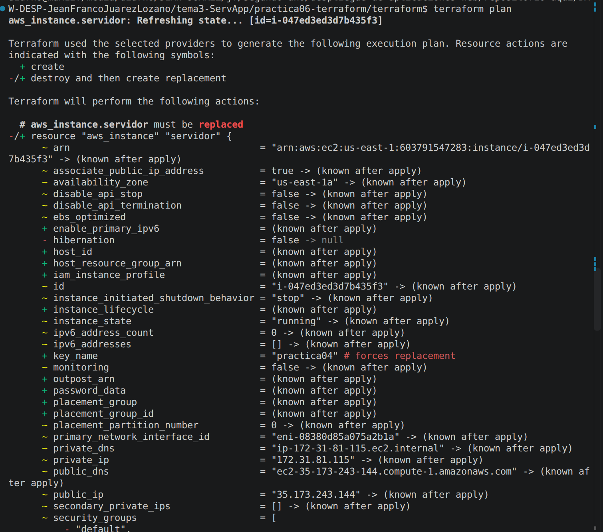 |
| 17 | `terraform apply` de la modificación | 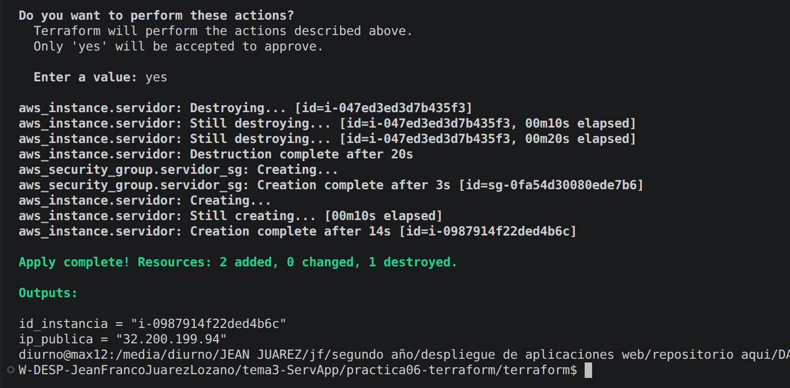 |
| 18 | Conexión SSH a la instancia | 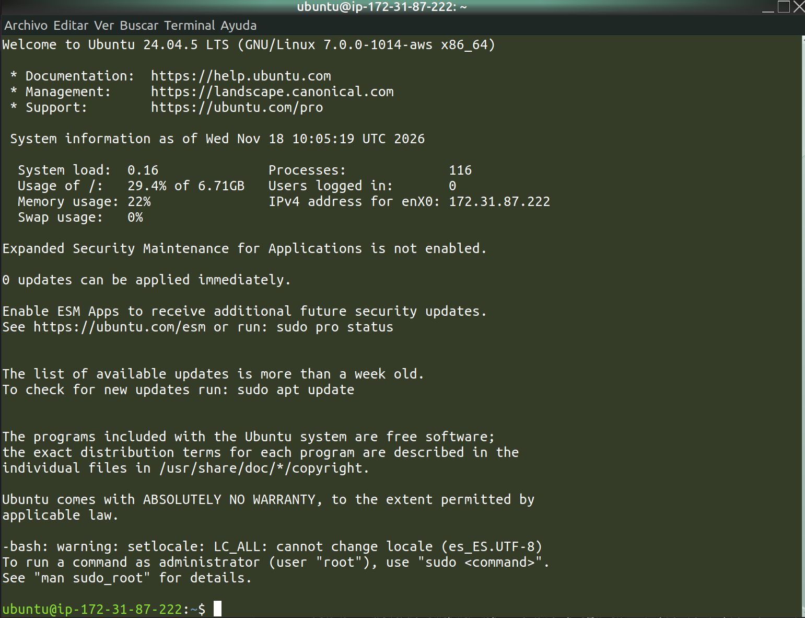 |

## 7. Análisis de las limitaciones de la infraestructura (Tarea 9)
Tras la primera ejecución, Terraform había creado una instancia EC2, pero no era administrable. Respuestas a las preguntas del enunciado:

| Pregunta | Respuesta |
|---|---|
| ¿Existe una clave SSH asociada a la instancia? | **No.** `main.tf` no define `key_name`, así que la instancia se creó sin Key Pair y en la consola aparece sin par de claves. |
| ¿Está abierto el puerto 22? | **No.** La instancia usa el Security Group *default* de la VPC, que no permite tráfico de entrada desde Internet. |
| ¿Existe algún Security Group configurado? | Solo el *default* de la VPC. Terraform no creó ninguno adecuado. |
| ¿Está abierta la comunicación HTTP o HTTPS? | **No**, por el mismo motivo: no hay reglas de entrada para los puertos 80 y 443. |

**Conclusión:** Terraform creó la instancia, pero la infraestructura es todavía incompleta: no hay Key Pair, no hay un Security Group adecuado y no es posible conectarse por SSH. Por eso se amplió el código en la Tarea 10.

## 8. Modificación de la infraestructura (Tarea 10)
Se añadió el Security Group y el Key Pair. Al ejecutar `terraform plan` apareció el Security Group como recurso nuevo (`+`) y la instancia marcada para **reemplazo** (`-/+`, `forces replacement`): añadir `key_name` obliga a destruir y recrear la instancia, porque el par de claves solo se asocia en el momento de crearla. Por eso, tras el `apply`, la instancia tiene un ID y una IP pública distintos a los de la primera fase.

Resultado del plan: «COMPLETAR: línea `Plan: X to add, 0 to change, Y to destroy` de tu captura 16».

Después, `terraform output` dio la nueva IP y se pudo entrar con `ssh -i practica04.pem ubuntu@IP_PUBLICA` (captura 18).

## 9. Análisis final (Tarea 12)

### Infrastructure as Code: ¿qué significa?
Definir y gestionar la infraestructura (servidores, redes, firewalls) mediante ficheros de código versionables, en lugar de configurarla a mano desde una consola.

### Terraform: ¿qué ventajas aporta frente a la creación manual de recursos?
Es reproducible, rápido, versionable en Git y menos propenso a errores humanos. La misma definición puede aplicarse en otra cuenta o región, y la infraestructura queda documentada en el propio código.

### Security Groups: ¿qué función desempeñan?
Actúan como firewall virtual de la instancia: controlan qué tráfico puede entrar y salir según puerto, protocolo y origen.

### Key Pairs: ¿por qué son necesarias?
Permiten autenticarse por SSH mediante criptografía de clave pública. AWS instala la clave pública en la instancia y el administrador usa la privada (`.pem`), sin contraseñas. Sin ellas no se puede acceder a la instancia.

### `terraform init`: ¿para qué sirve?
Prepara el directorio de trabajo: descarga el provider (aquí `hashicorp/aws`) en `.terraform/` y crea el fichero de bloqueo de versiones `.terraform.lock.hcl`.

### `terraform plan`: ¿para qué sirve?
Compara el código con el estado actual y muestra qué recursos se crearán, modificarán o destruirán, sin hacer ningún cambio. Permite revisar antes de aplicar.

### `terraform apply`: ¿para qué sirve?
Ejecuta en AWS los cambios del plan, tras pedir confirmación, y actualiza el fichero de estado (`terraform.tfstate`).

### `terraform destroy`: ¿para qué sirve?
Elimina todos los recursos gestionados por la configuración. Evita dejar recursos activos innecesarios y consumir crédito.

### Automatización: ¿qué ventajas presenta Terraform para equipos DevOps?
Entornos idénticos y repetibles, revisión de cambios en Git como si fuera código, integración con CI/CD, colaboración en equipo y menos errores humanos.

### Automatización: ¿qué ventajas presenta frente a la creación manual de recursos?
Se evita repetir pasos en la consola, se ahorra tiempo, se reduce el riesgo de olvidar o configurar mal algo y se puede recrear o destruir todo el entorno en minutos con el mismo resultado.

## 10. Problemas encontrados

1. Por ejemplo, no saber dónde ejecutar los `export` de las credenciales (Tarea 3).»

## 11. Soluciones aplicadas

| Problema | Causa | Solución |
|---|---|---|
| Las credenciales no se reconocían o no se sabía dónde ejecutar los comandos | Las variables de entorno solo existen en la terminal donde se ejecutan los `export` | Ejecutar los `export` en la misma terminal Ubuntu donde se lanza Terraform y comprobar con `env \| grep AWS_` |

## 12. Conclusiones
Esta práctica me ha mostrado la diferencia entre crear infraestructura a mano y definirla como código. Con unos pocos ficheros, Terraform creó la instancia y, al ampliarlos, la recreó con su Security Group y su Key Pair, de forma repetible. También he visto que una máquina creada no es necesariamente una máquina utilizable: sin Key Pair ni Security Group adecuado no se podía administrar, y el `plan` me permitió revisar el impacto antes de aplicar, incluido el reemplazo de la instancia.

**Mejoras posibles:** limitar el SSH a mi IP en lugar de `0.0.0.0/0`, instalar Docker automáticamente con `user_data`, definir la clave y la AMI como datos dinámicos, guardar el estado en un backend remoto y ejecutar `terraform destroy` al terminar para no consumir crédito.