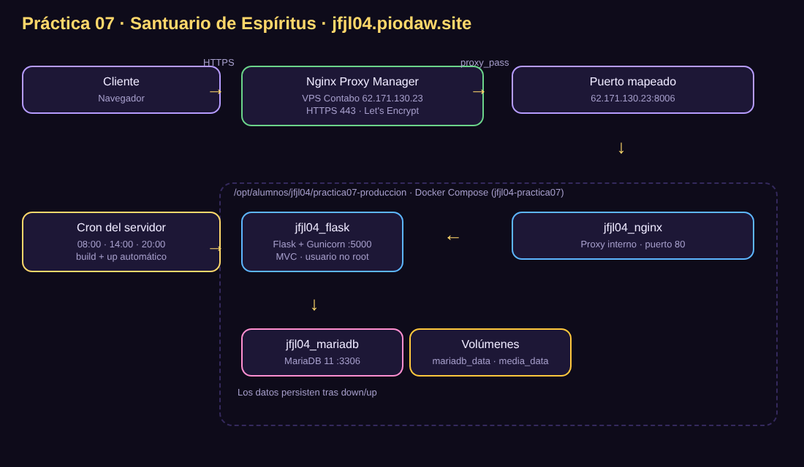
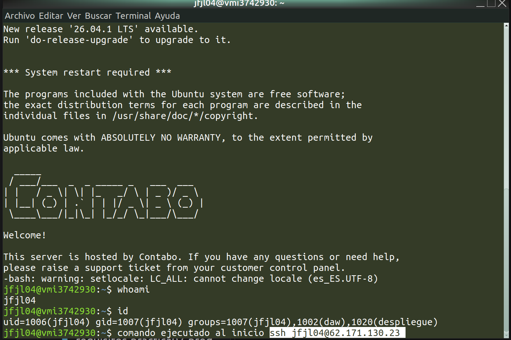
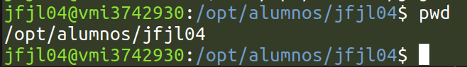
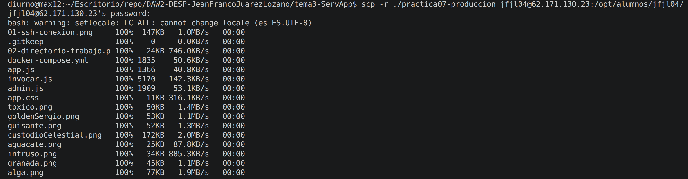
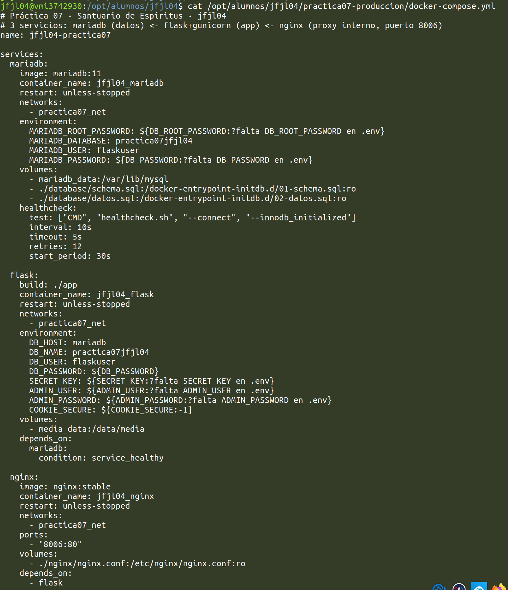
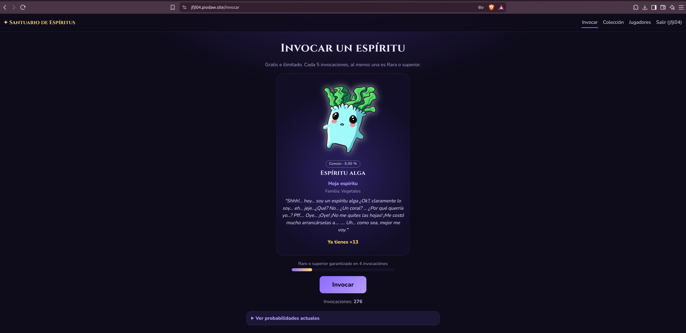
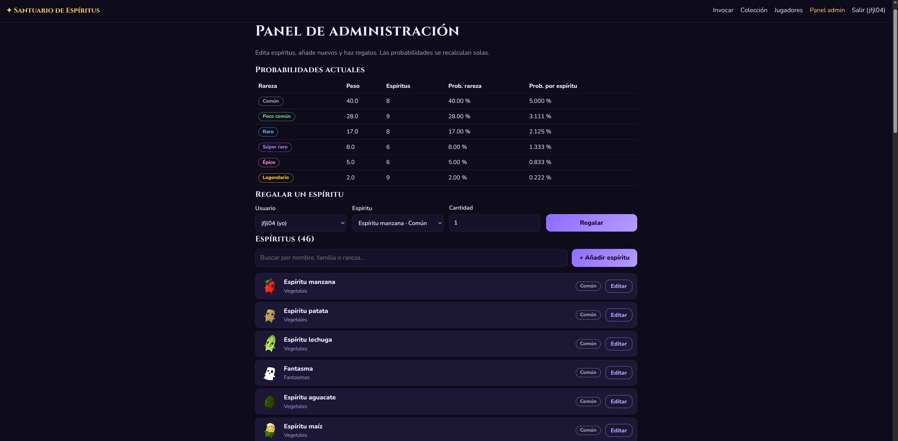

# Práctica 07 · Despliegue en producción — Santuario de Espíritus

**Alumno:** Jean Franco Juárez Lozano (`jfjl04`) · **URL:** https://jfjl04.piodaw.site · **VPS:** 62.171.130.23 · **Puerto interno:** 8006

## 1. Introducción
«Santuario de Espíritus» es un juego web propio: cada usuario invoca espíritus (gratis e ilimitado), los colecciona, desbloquea fichas y ve las colecciones de otros jugadores. Hay 45 espíritus en 6 rarezas (Común → Legendario) y cada 5 invocaciones se garantiza al menos uno Raro o superior. Los espíritus aún no conseguidos aparecen como «?» y su ficha es inaccesible.

Hay un panel de administración (acceso separado bajo el login) para editar espíritus, añadir nuevos con imagen, y regalar espíritus a cualquier usuario.

## 2. Arquitectura
```
Navegador ──HTTPS──> Nginx Proxy Manager (443, certificado) ──HTTP──> VPS:8006
                                                                     │
                                          ┌──────────── Docker Compose (jfjl04-practica07) ─────────────┐
                                          │ nginx :80  ──>  flask + gunicorn :5000  ──>  mariadb :3306  │
                                          │                      │ volumen media_data     │ volumen mariadb_data
                                          └───────────────────────────────────────────────────────────┘
```
- **nginx** (contenedor): proxy inverso interno, único servicio publicado (`8006:80`).
- **flask**: aplicación (Gunicorn, 2 workers) ejecutada como usuario no root.
- **mariadb**: datos en volumen con nombre; se inicializa con `database/schema.sql` y `datos.sql`.
- El HTTPS lo termina Nginx Proxy Manager del profesor; mi stack solo habla HTTP en el puerto 8006.

Estructura:
```
practica07-produccion/
├── docker-compose.yml  ├── .env (no se sube a Git)  ├── .env.example
├── app/   app.py (Controlador) · models.py (Modelo) · imagenes.py · templates/ (Vista) · static/ · seed_pictures/ · Dockerfile
├── database/ schema.sql · datos.sql
├── nginx/ nginx.conf
└── capturas/
```

## 3. Patrón MVC
| Capa | Dónde | Qué hace |
|---|---|---|
| Modelo | `app/models.py` | Consultas a MariaDB y reglas (invocación, probabilidades, garantía, regalos) |
| Vista | `app/templates/`, `static/` | HTML con Jinja2, CSS y JS (sin scripts inline) |
| Controlador | `app/app.py` | Rutas, sesiones, CSRF, permisos; une modelo y vistas |

## 4. Base de datos
Tablas: `rarezas`, `familias`, `espiritus`, `usuarios`, `colecciones` (PK compuesta usuario+espíritu con `cantidad`). Las probabilidades **no se guardan**: se calculan al consultar. Cada rareza tiene un peso fijo (40/28/17/8/5/2); el porcentaje se reparte entre los espíritus de esa rareza. Si añado o cambio de rareza un espíritu, las cifras se ajustan solas.

## 5. Funcionalidades y seguridad
- Login con usuario EducaMadrid (se acepta `usuario` o `usuario@educa.madrid.org`) y contraseña con hash. *(No es posible validar contra EducaMadrid real, por eso las cuentas son propias.)*
- Bajo el login: **«Iniciar sesión como moderador o administrador»**. Solo la cuenta admin (`jfjl04`, creada desde `.env`) obtiene el panel (caduca a las 2 h).
- Panel: editar nombre/subtítulo/descripción/rareza/familia/imagen, añadir espíritus (campos obligatorios, imagen ideal 512×512, familia existente o nueva) y regalar espíritus (a cualquier usuario, incluido uno mismo).
- Protecciones: token CSRF, cabeceras CSP estrictas, cookies HttpOnly/Secure/SameSite, límite de intentos de login, subidas validadas y reescritas con Pillow, consultas parametrizadas, sorteo hecho en el servidor.

## 6. Despliegue (cron del profesor)
1. Conexión SSH al VPS con mi usuario (`ssh jfjl04@62.171.130.23`) y comprobación de grupo `daw`.
2. Trabajo siempre en `/opt/alumnos/jfjl04`.
3. Transferencia desde mi equipo: `scp -r ./practica07-produccion jfjl04@62.171.130.23:/opt/alumnos/jfjl04/` (incluye el `.env`, que no está en Git).
4. `docker-compose.yml` con mi puerto exclusivo `"8006:80"`.
5. No ejecuto `docker compose up/down/restart`: el cron del servidor (08:00, 14:00 y 20:00) reconstruye y reinicia los servicios.
6. Nginx Proxy Manager ya publica `https://jfjl04.piodaw.site` → `62.171.130.23:8006` con certificado Let's Encrypt.



## 7. Evidencias

### Tarea 1 · Conexión SSH
COMPLETAR (una frase: conexión con `ssh jfjl04@62.171.130.23`, `whoami` e `id` con el grupo `daw`).


### Tarea 2 · Directorio de trabajo
COMPLETAR (una frase: `cd /opt/alumnos/jfjl04` y `pwd`).


### Tarea 3 · Transferencia del proyecto
COMPLETAR (una frase: `scp -r` del proyecto al VPS).


### Tarea 4 · docker-compose.yml
COMPLETAR (una frase: puerto `8006:80`, volúmenes, healthcheck, nombres con prefijo `jfjl04_`).


### Tarea 5 · Publicación tras la ventana de cron
COMPLETAR (hora de la ventana de despliegue en la que apareció la aplicación).


### Tarea 7 · Verificación final y cambio guardado en la BD
COMPLETAR (qué cambio hice —por ejemplo editar la descripción de un espíritu como administrador— y cómo se ve tras recargar).


### Tarea 8 · Aplicación mejorada (MVC)
Es el propio «Santuario de Espíritus»: Modelo (`models.py`), Vista (`templates/`) y Controlador (`app.py`), descritos en los apartados 3 a 5.

## 8. Cuestionario de reflexión (Tarea 9)
**1. Gestión de usuarios y permisos: ¿por qué trabajo en `/opt/alumnos/<usuario>` con mi propio usuario y no con `root`?**
Porque el VPS lo comparten 16 alumnos. Mi usuario solo tiene permisos sobre mi carpeta, así que un error mío (un `rm` mal escrito, un `scp` a la ruta equivocada) no puede tocar los proyectos de los demás ni el sistema. `root` puede hacerlo todo y cualquier fallo o intrusión tendría efecto sobre todo el servidor. Además queda constancia de quién hizo cada cosa, y se aplica el principio de mínimo privilegio. Por la misma razón, dentro del contenedor Flask corre con un usuario sin privilegios (`app`) y no como root.

**2. Puertos y proxy inverso: ¿qué hace Nginx Proxy Manager y por qué no se expone la aplicación directamente en el puerto 80?**
NPM es la puerta de entrada pública: recibe el tráfico en 80/443, termina el HTTPS con el certificado Let's Encrypt y reenvía cada subdominio al puerto interno de cada alumno (el mío, `jfjl04.piodaw.site` → 8006). El puerto 80 del VPS ya lo usa NPM y solo uno puede usarlo; por eso cada alumno publica un puerto propio (8001-8016). Así hay un único punto de entrada cifrado y centralizado, y Flask y MariaDB nunca quedan expuestos directamente a Internet.

**3. Persistencia: si ejecuto `docker compose down` y luego `up -d`, ¿se pierden los datos de MariaDB?**
No. `down` elimina los contenedores y la red, pero los datos están en volúmenes con nombre (`mariadb_data` para la base de datos y `media_data` para las imágenes), que se conservan. Al hacer `up`, MariaDB vuelve a montar el mismo volumen y encuentra sus datos; no repite los scripts de `docker-entrypoint-initdb.d`, que solo se ejecutan con el volumen vacío. Solo `docker compose down -v` borraría los datos.

## 9. Problemas encontrados y soluciones
| Problema | Solución |
|---|---|
| Colisión de nombres con otros compañeros (misma carpeta) | `name: jfjl04-practica07` y `container_name` con prefijo `jfjl04_` |
| Flask arrancaba antes que MariaDB | `healthcheck` + `depends_on: service_healthy` y reintentos al arrancar |
| Nginx fallaba si Flask no existía aún | `resolver 127.0.0.11` + `proxy_pass` con variable |
| Subida de imágenes sin control | Validación con Pillow, reescritura a PNG 512×512 y nombre generado |
| COMPLETAR (problemas reales que encuentres) | COMPLETAR |

## 10. Conclusiones
COMPLETAR (qué has aprendido: contenedores, volúmenes, proxy inverso, automatización con cron, seguridad).
